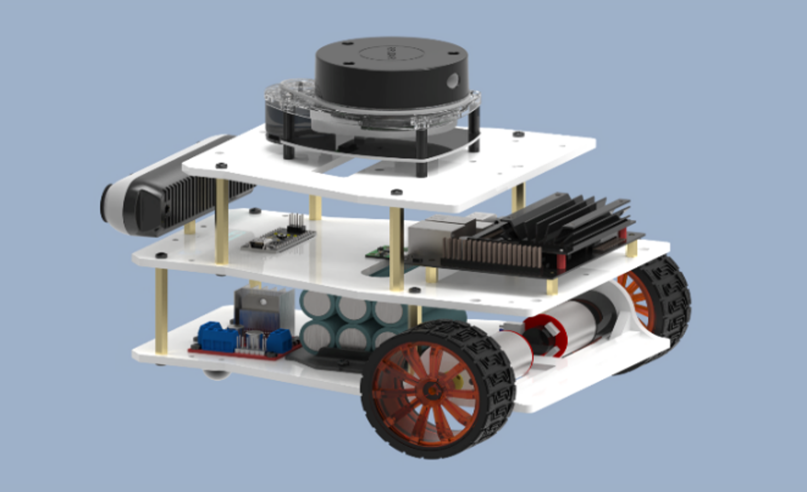
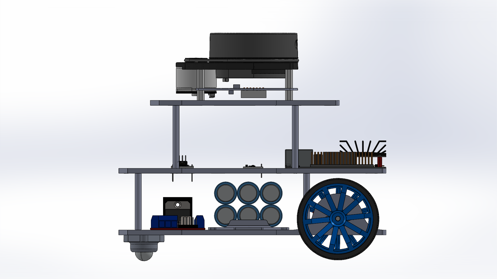

# Mini Swarm Vehicle

A small, modular ground robot built as a platform for developing and testing swarm-robotics and autonomous-navigation concepts — self-designed mechanical chassis, electronics, and low-level motor control, driven by an NVIDIA Jetson for onboard autonomy.



## Overview

The vehicle is a compact two-wheel differential-drive robot (2 rear geared DC motors + 1 passive front caster) with onboard IMU, 2D LiDAR, and a depth camera for perception, intended to operate individually or as part of a coordinated swarm. It's built around a 3-plate 3D-printed chassis, an Arduino-based low-level motor/encoder controller, and a Jetson Nano for higher-level compute — the same compute/sensing pattern later reused as a multi-vehicle swarm navigation platform.

## Mechanical Design



- **Frame:** 3 plates (bottom, middle, top), FDM 3D-printed in CPE (copolyester) — chosen for impact resistance, flexibility, and dimensional stability.
  - **Bottom plate** — mounts the drive motors, caster wheel, and power electronics, with reinforced ribs at the motor mounts.
  - **Middle plate** — hosts the Jetson module and camera, with routed cable-management slots.
  - **Top plate** — carries the 2D LiDAR on a raised standoff mount, plus ventilation/wiring cutouts.
- **Validation:** structure was checked under a 2 kg payload via FEA, confirming minimal deformation at the reinforced motor-mount regions.
- **Assembly:** modular sandwich construction held together with M3 screws/standoffs for easy maintenance and component swaps.

Full writeups: [`docs/Mechanical_Structure.docx`](docs/Mechanical_Structure.docx), [`docs/Technical_Description.docx`](docs/Technical_Description.docx), chassis plate drawings in [`docs/Chassis_Plates.pdf`](docs/Chassis_Plates.pdf).

## Electronics

Schematic and PCB project designed in Altium (`hardware/altium/`): a two-wheel drive-controller board (`Main.SchDoc`) alongside the system block diagram (`Block_Diagram.SchDoc`). PDF export in `docs/Schematic.pdf`; system-level electrical/architecture diagrams in `docs/Electrical_Block_Diagram.vsdx` and `docs/System_Overview.vsdx`.

**Core hardware:** Arduino (low-level motor/encoder control), Jetson Nano (onboard compute), encoder DC motors + motor driver shield, IMU, 2D LiDAR, depth camera, Li-ion battery.

## Firmware

`firmware/ROSArduinoBridge/` is the Arduino-side motor/encoder driver, based on the open-source [ROSArduinoBridge](https://github.com/joshnewans/ros_arduino_bridge) library (included here largely unmodified for completeness; see `UPSTREAM_README.md` for the original project). It exposes a serial command interface so a high-level computer (e.g. running ROS) can drive the motors and read back encoder data.

## Repository Structure

```
hardware/altium/   Altium project — block diagram & drive-controller schematic, schematic library
firmware/          Arduino motor/encoder controller (ROSArduinoBridge-based)
docs/              Technical description, mechanical structure doc, chassis plate drawings, schematic PDF, block/system diagrams
images/            Assembly photos, built vehicle, chassis CAD renders
```

## Author
This project is done by the following team members
- Dr.Muhammad Ahmad Kamran (Team Lead), AITeC Islamabad
- Muhammad Huzaifa Rahim Malik (Electronics Design), AITeC Islamabad
- Muhammad Mohsin Razaqi (Mechanical Design), AITeC Islamabad 
- Muhammad Awais Khan (Algorithm Design), AITeC Islamabad
